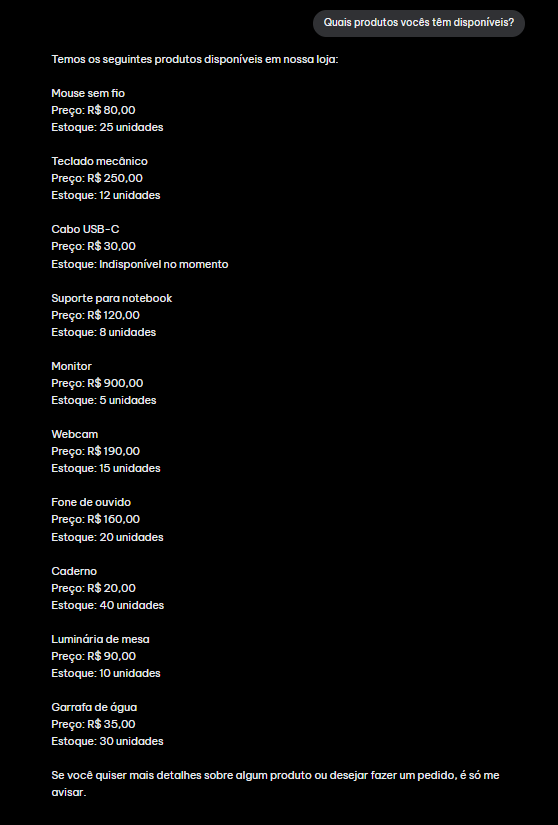
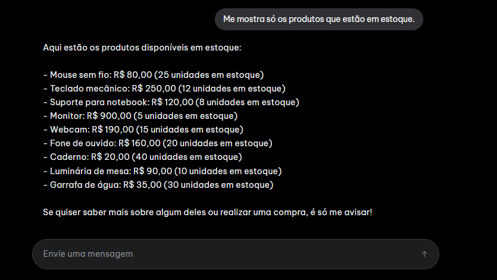
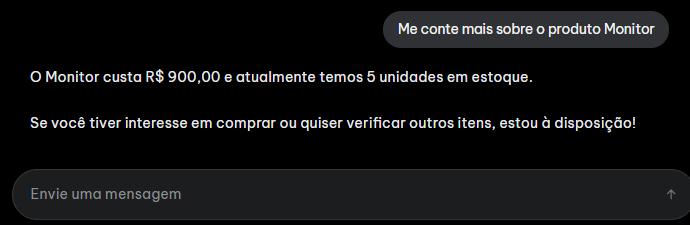
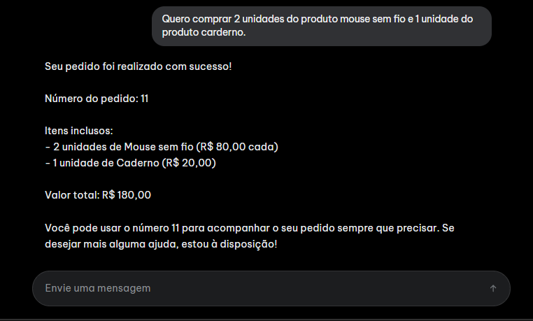
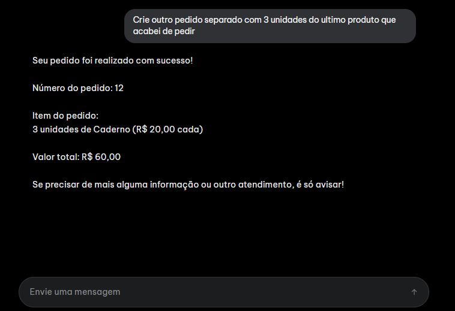
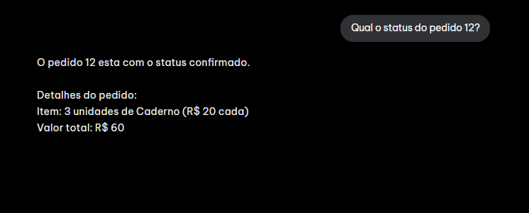
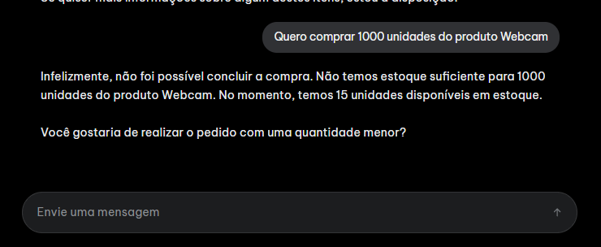
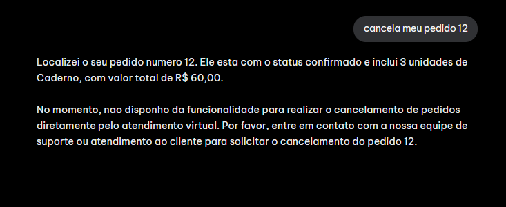

# AI Store Agent 🛍️

Agente conversacional desenvolvido em Node.js e TypeScript para uma loja virtual. A aplicação permite que usuários consultem produtos, verifiquem pedidos e realizem compras por meio de uma interface de conversa.

O agente utiliza um modelo de linguagem integrado a ferramentas (*tool calling*) para interagir com uma API HTTP que simula o backend de uma loja virtual.

## ✨ Funcionalidades

- **Consulta de produtos:** listagem de produtos disponíveis e consulta de detalhes individuais.
- **Consulta de pedidos:** verificação do status de pedidos existentes.
- **Criação de pedidos:** realização de compras com validação de produtos, quantidades e estoque.
- **Memória conversacional:** manutenção do contexto de cada conversa por meio de sessões independentes.
- **Tool calling:** utilização de ferramentas para executar operações reais na API da aplicação.
- **Tratamento de erros:** respostas adequadas para situações como produtos inexistentes, estoque insuficiente e indisponibilidade de serviços externos.

## 🛠️ Tecnologias utilizadas

| Tecnologia | Finalidade |
|---|---|
| Node.js | Ambiente de execução |
| TypeScript | Tipagem forte em todo o backend |
| Fastify | Servidor HTTP, com desempenho alto e validação integrada |
| Zod | Validação em runtime e contratos das ferramentas |
| LangChain.js | Agente, system prompt, ferramentas e troca de modelo |
| Google Gemini Flash | Modelo de linguagem utilizado |
| LangGraph MemorySaver | Gerenciamento da memória conversacional em sessões |

## 📋 Pré-requisitos

Antes de executar o projeto, certifique-se de ter instalado:

- [Node.js](https://nodejs.org/) (versão compatível com o projeto).
- npm (instalado junto com o Node.js).
- Uma API Key do Google AI Studio para utilizar o Gemini.

## 🚀 Como executar

### 1. Clonar o repositório

```bash
git clone https://github.com/nicolasandreos/desafio_tecnico_runflow.git
cd desafio_tecnico_runflow
```

### 2. Instalar as dependências

```bash
npm install
```

### 3. Configurar as variáveis de ambiente

Crie um arquivo `.env` na raiz do projeto, seguindo o modelo disponibilizado em `.env.example`.

Exemplo:

```env
APP_PORT=3000
GOOGLE_API_KEY=sua_api_key
GEMINI_MODEL=seu_modelo_configurado
VITE_AGENT_BASE_URL=http://127.0.0.1:3000
CLIENT_API_BASE_URL=http://127.0.0.1:5050/api/v1
```

Substitua os valores pelos dados correspondentes à sua configuração.

### 4. Executar o projeto

```bash
npm run dev:all
```

A aplicação subirá o frontend, mock api e o agente.

## 🏗️ Arquitetura e decisões técnicas

### 1. TypeScript

Todo o backend foi escrito em **TypeScript** para manter tipagem forte de ponta a ponta: entidades da loja, parâmetros das ferramentas, corpos das requisições e respostas da API.

A tipagem torna o contrato entre a API mock, as ferramentas e o agente explícito no código. Um produto, um item de pedido ou o corpo do `POST /chat` não precisam ser reinterpretados a cada camada. Isso reduz erro de integração e deixa a refatoração mais segura.

Os dados que entram pela rede continuam sendo conferidos com Zod

### 2. Fastify

O servidor HTTP da API mock e o do agente usam **Fastify**. A escolha partiu de quatro pontos:

- **Desempenho.** O Fastify trata mais requisições por segundo que o Express, com menos custo por request. Neste projeto o volume é pequeno, mas o framework já nasce com esse perfil e não exige trocar de base se a loja crescer.
- **TypeScript.** O framework expõe tipos para rotas, request e reply. O handler do chat e os endpoints de produtos e pedidos ficam alinhados ao restante do backend tipado.
- **Validação de schemas.** O Fastify valida a entrada da rota a partir de um schema. Aqui essa validação é feita com Zod, o mesmo mecanismo usado nos parâmetros das ferramentas. Uma compra malformada, um id vazio ou uma quantidade inválida é recusada antes de virar regra de negócio.

### 3. LangChain.js

O agente foi montado com **LangChain.js** porque a integração com modelos diferentes é simples e a configuração do agente fica concentrada em um só lugar.

Trocar o modelo não exige reescrever o ciclo de conversa. O identificador fica na variável `GEMINI_MODEL`, e o agente chama esse modelo com o mesmo system prompt, as mesmas ferramentas e o mesmo histórico. Outro LLM compatível com a biblioteca entra no mesmo encaixe.

A configuração do agente reúne, de forma direta:

- **System prompt:** as regras de atendimento, o que pode ser dito ao cliente e o que deve ser consultado na loja.
- **Tools:** cada operação da loja é uma ferramenta com nome, descrição e schema. O modelo decide quando chamá-la; a ferramenta executa o HTTP.
- **Memória:** o `MemorySaver` do LangGraph guarda o histórico por `sessionId`. Conversas diferentes não se misturam, e uma mensagem seguinte reaproveita o que já foi dito naquela sessão.

O LangChain conduz o ciclo que, feito à mão, seria um loop de *function calling*:

1. Envio do contexto e da mensagem ao modelo.
2. Identificação da necessidade de utilizar uma ferramenta.
3. Execução da ferramenta solicitada.
4. Retorno do resultado ao modelo.
5. Geração da resposta final para o usuário.

### 4. Escolha do LLM

Foi escolhido o **Google Gemini Flash** como modelo de linguagem por oferecer uma boa relação entre velocidade, capacidade de processamento e disponibilidade de utilização gratuita.

Outro fator importante foi o suporte ao *function calling*, recurso necessário para o LangChain acionar as ferramentas da loja. Como a integração passa pela biblioteca, o modelo pode ser substituído depois sem mexer nas regras de estoque, pedido e validação.

### 5. Estruturação do agente

O agente foi organizado em torno de ferramentas com responsabilidades específicas:

| Ferramenta | Responsabilidade |
|---|---|
| `list_products` | Consultar os produtos disponíveis |
| `get_product` | Consultar detalhes de um produto específico |
| `get_order_status` | Consultar o status de um pedido |
| `create_order` | Criar um novo pedido |

O modelo de linguagem é responsável por interpretar as solicitações do usuário e decidir quais ferramentas devem ser utilizadas.

As ferramentas, por sua vez, executam as operações por meio de requisições HTTP à API da aplicação.

Essa separação permite que o LLM cuide da interpretação da linguagem natural, enquanto as regras de negócio permanecem sob responsabilidade do backend.

### 6. API e regras de negócio

Foi desenvolvida uma API HTTP para simular o backend de uma loja virtual.

Ela disponibiliza operações para:

- Listar produtos.
- Consultar um produto específico.
- Consultar pedidos.
- Criar pedidos.

A API é a fonte de verdade dos dados e das regras de negócio. Dessa forma, o agente não decide por conta própria se um produto existe ou se há estoque disponível.

As validações são executadas no backend, independentemente das instruções fornecidas ao modelo.

Essa decisão evita depender exclusivamente do comportamento do LLM para garantir a integridade das operações.

### 7. Memória e gerenciamento de sessões

A memória faz parte da configuração do agente no LangChain. Foi utilizado o mecanismo de checkpoint do LangGraph com `MemorySaver`.

Cada conversa possui um identificador de sessão (`sessionId`), utilizado como `thread_id` na configuração do agente.

Isso permite que diferentes conversas mantenham históricos independentes.

A memória utilizada é armazenada em memória RAM, sendo suficiente para o escopo deste desafio. Entretanto, ela não é persistente: os dados são perdidos quando a aplicação é reiniciada.

### 8. Validação de dados

Foi utilizado Zod tanto na borda HTTP do Fastify quanto nos parâmetros das ferramentas do LangChain.

Na API, o schema recusa corpo e parâmetros inválidos antes da regra de negócio. Nas ferramentas, o mesmo estilo de schema descreve o que o modelo pode enviar, e o tipo TypeScript é inferido dali. A validação evita entradas inválidas e mantém um contrato único entre a requisição, a ferramenta e o código que a executa.

## 🎯 Decisões de escopo

Algumas funcionalidades e características foram intencionalmente deixadas de fora para manter o desenvolvimento focado nos requisitos do desafio.

- **Banco de dados persistente:** os dados da loja são simulados em memória.
- **Autenticação e autorização:** não foi implementado um sistema completo de usuários.
- **Memória persistente:** as sessões não sobrevivem à reinicialização da aplicação.
- **Atualização de pedidos existentes:** o escopo contempla a criação e consulta de pedidos, sem implementar operações de edição ou cancelamento.

Essas decisões priorizam a demonstração do funcionamento do agente, do uso de ferramentas e da integração entre o LLM e uma API externa.

## 🔮 Melhorias futuras

Com mais tempo de desenvolvimento, algumas melhorias seriam implementadas:

- **Persistência de dados:** substituir os dados em memória por um banco de dados, como PostgreSQL.
- **Memória persistente:** utilizar um mecanismo de checkpoint com armazenamento durável, permitindo recuperar conversas após reinicializações.
- **Autenticação:** implementar autenticação e associar sessões aos respectivos usuários.
- **Observabilidade:** adicionar logs estruturados, rastreamento das chamadas às ferramentas e métricas de execução do agente.
- **Resiliência:** implementar estratégias de retry com backoff exponencial, timeout e circuit breaker para chamadas do agente aos serviços externos(API mock).
- **Testes automatizados:** ampliar a cobertura de testes unitários, integração e cenários conversacionais.
- **Experiência do usuário:** melhorar a interface com indicadores de carregamento e feedbacks visuais melhores para o usuário.

## 📸 Demonstração

### 1. Listagem de produtos



### 2. Produtos em estoque



### 3. Detalhes de um produto



### 4. Preço de um produto


### 5. Criação de pedido



### 6. Continuidade da conversa



### 7. Consulta de pedido



### 8. Produto inexistente


### 9. Estoque insuficiente



### 10. Pedido inexistente


### 11. Cancelamento de pedido



### 12. Assunto fora da loja


